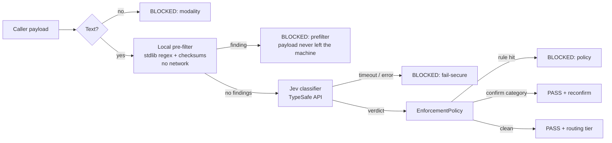

# SieveGate architecture

SieveGate is a library, not a service. Your code calls `SieveGate.evaluate_payload(prompt)` before it calls an LLM. SieveGate returns a decision and never makes the LLM call itself.

## Pipeline

The order inside `SieveGate.evaluate_payload` ([`src/sieve.py`](../src/sieve.py)):

1. **Modality and empty checks.** v1 processes text only. Anything else (bytes, dicts, `None`) or an empty or whitespace-only string is blocked.
2. **Local pre-filter** ([`src/prefilter.py`](../src/prefilter.py)), in `enforce` mode by default. Any finding blocks the payload, and the classifier is not called.
3. **Classifier**, with a timeout: one call that returns both the compliance verdict and the routing recommendation.
4. **Fail-secure validation** of the classifier's output, then **the enforcement policy** and **reconfirmation**.

Every result is a frozen `ClassificationResult`, so it can't be modified after the gate decides, which suits an audit log. Results carry reason codes and exception type names only, never payload text.

## The swappable classifier

SieveGate depends on the abstract [`Classifier`](../src/classifier.py) interface, with one async method: `classify(payload) -> ClassificationResult`. It never depends on a vendor SDK. Three implementations exist today:

- A TypeSafe Jev adapter: the production classifier, included in the commercial edition.
- `MockClassifier`: configurable results for tests.
- `ReplayClassifier` ([`demo/replay_classifier.py`](../demo/replay_classifier.py)): replays recorded answers for the demo.

**Why it exists:** Jev is a closed model controlled by one vendor. The paradigm SieveGate relies on (one fast call that returns structured judgments with probabilities) is more durable than any single vendor. The policy reads only vendor-neutral verdict fields (`pii_probability`, `secret_probability`, `financial_probability`, `data_leak_risk`, `leak_risk_confidence`, `content_category`) and never a vendor's question names, so another classifier can replace Jev without changing the policy.

The Jev adapter asks six questions in a single call: three yes/no questions (personal data, secrets, financial records), a 0–4 leak-risk score, a 10-label content category and a model tier.

## Fail-secure

There is **one timeout and one blocked path.** `SieveGateSettings.classify_timeout_seconds` defaults to 2 s. Jev's published response time is a range (70–500 ms), so "slow" is a routine case, and it is treated exactly like "dropped". Each of these blocks the payload, with `error` set to a short reason:

- the classifier raises, or times out
- it returns something that isn't a `ClassificationResult`
- it returns a signal outside 0–1, or a NaN (a NaN compares false with every threshold, so without this check it could slip past every rule)
- the policy itself raises
- the pre-filter raises

Errors are reported by **exception type name only**, for example `classifier error: RuntimeError`. SDK error messages can echo the request body, so copying them would leak the payload into results and logs.

The TypeSafe adapter turns the SDK's automatic retries off on every call, so a failure is never silently repeated.

## Enforcement policy and observe mode

`EnforcementPolicy` ([`src/policy.py`](../src/policy.py)) evaluates every rule and reports every hit as a reason code. Any one hit blocks. The defaults are zero-trust:

- personal data ≥ 0.30, secret ≥ 0.50, financial ≥ 0.50
- leak risk ≥ 0.50, or leak-risk confidence < 0.30 (unsure means block)
- a set of blocked content categories: credentials, customer PII, employee HR, health records, legal contracts and infrastructure/security details
- a missing signal blocks

Invalid configuration raises when the policy is built. Buyers can add their own rules (`extra_rules`) that see the classifier's result and a caller-supplied `context`. This is how a model-tier cap can be added without changing SieveGate.

In **observe mode** the policy runs in full, but its hits don't block: the result carries `would_block=True` and the reasons, so a buyer can measure false blocks on real traffic before enforcing. Fail-secure checks still block in observe mode.

## Reconfirmation

Some content is usually harmless but sometimes isn't. Finance text is the main case: a hypothetical budget is fine, while a real statement may not be. For categories in `confirm_categories` (default: `financial_records`) the gate doesn't block. It passes the payload with `needs_confirmation=True`, and the caller asks a person before sending. Truly sensitive financial data is still blocked by the financial-probability rule, and a block always wins over a reconfirmation request.

## The local pre-filter

Standard library only, offline, with 12 high-precision detectors: PEM private keys, AWS, GitHub, Slack, Stripe live, Google, and Anthropic/OpenAI keys, JWTs, credentialed URLs, Luhn+issuer-checked card numbers, SSA-valid SSNs, and mod-97-checked IBANs. Each detector cites the format source it was built from.

- **It can only make the gate stricter.** It returns findings (block) or no findings (continue to the classifier), never "safe".
- **Findings hold a kind, a detector ID and a span, never the matched text.** The caller already has the payload, so the spans reveal nothing new, and `redact(text, findings)` lets the caller redact locally and resend.
- **Regexes are written so hostile input can't make them slow.** Every pattern has a start anchor, so a long run of token characters has only one possible match start, and the quantifiers that must be searched past are bounded. A 1 MB payload scans in about 110 ms, and the adversarial inputs in the test suite take at most about 0.25 s.
- **Modes:** `enforce` (default), `observe` (record findings but still send the payload to the classifier) and `off`.

## What leaves the machine, and when

SieveGate never calls the LLM. "Leaves" below means sent to TypeSafe for classification.

| Outcome | Classifier called? | Payload sent to TypeSafe? |
|---|---|---|
| Blocked by modality (non-text or empty) | No | **No** |
| Blocked by the pre-filter (`enforce`) | No | **No** |
| Pre-filter error | No | **No** |
| Pre-filter finding in `observe` mode | Yes | **Yes, secrets included.** Use observe mode only on traffic you are allowed to send. |
| Classifier timeout or error | Yes | **Probably yes:** the request was made, but no answer arrived |
| Blocked by the policy | Yes | **Yes** (for classification only; your code must not then send it to the LLM) |
| Passed, or passed with a reconfirm request | Yes | **Yes**, and then your code sends it to the LLM |

## No payload text in logs

- Results, reasons and error strings contain codes and exception type names only. The test suite plants canary strings in payloads, exception messages and caller context, and checks that they never reach a result.
- **SDK DEBUG-logging guard:** the TypeSafe SDK logs full request bodies (that is, the payload) at DEBUG level, and applies `TYPESAFE_LOG_LEVEL` when a client is built. The adapter therefore raises the `typesafe_sdk` logger to INFO after building the client. This is a deliberate global side effect on that one logger: a leak-prevention library shouldn't let a debug setting write customer data to logs.
- The demo's replay recording stores Jev's answers and a SHA-256 fingerprint of each payload, never the text.

## Known limitations

- **No Unicode normalisation in the pre-filter.** Full-width, look-alike-character or otherwise obfuscated secrets are left to Jev.
- **Images and files are blocked by modality**, not screened. When conversion is added, it must run locally: sending an image to a cloud OCR or vision service would itself be the leak.
- **TypeSafe is a subprocessor** for every payload the pre-filter passes. Buyers' compliance teams will need TypeSafe's data-retention and processing terms.
- **Model-tier routing is advisory.** SieveGate recommends a tier and doesn't enforce one unless the buyer adds a rule. Tier accuracy (82.4% on the holdout) isn't yet validated for cost-saving claims.
